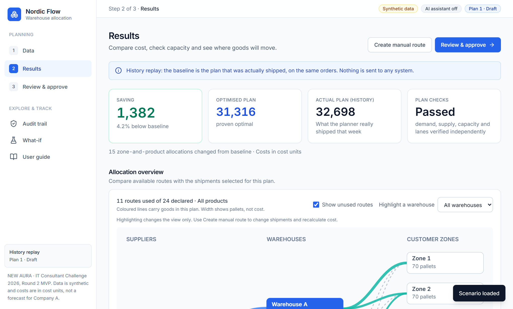

# Nordic Flow

**Lowest-cost supplier and warehouse allocation for a Nordic distributor, with a person approving every plan.**

Built by team **NEW AURA** for the IT Consultant Challenge 2026. We placed **top 4 out of 160 teams** after three rounds:
- a written proposal;
- a working MVP with documentation;
- a live pitch that answered a new brief: 30% less budget and a mandatory CRM migration.



> All data in this repository is **synthetic**, and costs are in cost units. Nothing here forecasts results for a real company.

## The problem

Company A is the fictional client in the case. It distributes building materials across Sweden, Denmark and Norway. Every week its planners must decide:

> *For each customer zone and product, which supplier and which existing warehouse should serve it, so that total freight and handling cost is lowest?*

Planners decided this by habit. Nordic Flow uses mathematical optimisation instead and keeps the planner in charge:

1. **Load** a week of data: eight CSV files or one ZIP.
2. **Calculate** two plans: a baseline and an optimised plan. The optimised plan is a MILP solved with OR-Tools (SCIP) and is proven optimal.
3. **Verify** both plans with an independent checker that tests demand, supply, capacity and lanes.
4. **Show the saving** only when the baseline is valid as well.
5. **Review**: the planner reads the explanation, overrides any decision with a reason, then approves or rejects the plan.
6. **Export** only approved plans. Every step goes into a **hash-chained audit trail**, which is tamper-evident (not tamper-proof).

The design rests on three principles:
- **Code calculates; AI only words.** An optional LLM assistant rewrites computed numbers as text and never produces a number itself.
- **A person approves everything.**
- **Synthetic data is always labelled.**

## What the project shows

| Round | Task | What we delivered |
|---|---|---|
| 1 | Proposal | Business case, a pilot in one country, scope and risks |
| 2 | MVP | A working local app, system context diagram, user journey, a demo video, AI usage journal |
| 3 | Live pitch to a changed brief | A two-track plan: a like-for-like **Dynamics 365 → Salesforce** CRM migration plus a cheap validation of Nordic Flow, at about €0.18–0.20M instead of €0.3M |

**The Round 3 idea.** A live pilot would need integrations the reduced budget could not pay for. We replaced it with **history replay**:
- Re-run 4–8 past weeks on the same orders and prices.
- Compare the optimised plan with the plan the planner *actually shipped*.
- Apply a **go/no-go gate**: at least 2% saving over at least 4 comparable weeks.

This turns about €40k into the "price of a decision", not a bet on an untested system.

## Features

- **Optimisation:** MILP for whole pallets or LP. Supports multi-warehouse transfer chains and direct supplier-to-customer lanes, with capacity counted at every warehouse visited.
- **Independent verifier:** each plan is checked separately from the solver that produced it.
- **Explain and override:**
  - shows why each allocation was chosen;
  - a full route cost ranking;
  - manual routes, with the cost recalculated;
  - what-if scenarios with pinned decisions.
- **Review and approve:** planner decisions carry a reason; only approved plans can be exported as a ZIP.
- **Audit trail:** a hash-chained event log that verifies itself in the app.
- **History replay:** upload `actual_plan.csv` and the real shipped plan becomes the baseline. If that plan fails verification, no saving is shown.
- **Pilot evidence page:**
  - replays several weeks and reaches a GO / NO-GO / NOT_DECIDED decision;
  - calculates the business case and break-even;
  - checks the Dynamics → Salesforce customer code map;
  - downloads a CSV report.
- **User guide in the app**, with downloadable sample cases.

| Review and audit | |
|---|---|
|  |  |

## Tech stack

- **Core:** Python, OR-Tools (SCIP for MILP, GLOP for LP).
- **API:** FastAPI, with SQLite for plans, decisions and the audit log.
- **Frontend:** React, Vite and Tailwind CSS. The production build is served by FastAPI.
- **Tests:** pytest (302 tests) and Playwright browser walkthroughs.

## Run it locally (Windows)

```powershell
cd mvp
python -m venv .venv
.\.venv\Scripts\python.exe -m pip install -r requirements.txt
.\.venv\Scripts\python.exe -m pytest -q
.\.venv\Scripts\python.exe -m uvicorn api.main:app --port 8000
```

Open http://localhost:8000 and choose a sample:
- **Synthetic demo:** 2 suppliers, 3 warehouses, 6 customer zones, 606 pallets.
- **Worked example:** a small case that can be checked by hand.
- **History replay:** a week compared with the plan that was actually shipped (saving 1,382 cost units, 4.2%).

To replay four weeks from the command line:

```powershell
.\.venv\Scripts\python.exe -m nordic_flow replay data\history
```

This reports a total saving of 3.16% on synthetic data. The figure is a demonstration, not a forecast.

The AI assistant is optional and off by default. To enable it, copy `mvp/.env.example` to `.env` and set your own key. Keys are read only from environment variables.

## Repository layout

```text
mvp/
  nordic_flow/   Python core: optimiser, verifier, replay, pilot gate, reporting
  api/           FastAPI app, use cases, SQLite, audit trail
  frontend/      React + Vite source
  web/           Production build served by FastAPI
  data/          Synthetic samples, including data/history for replay
  tests/         pytest suite and browser walkthroughs
deliverables/    Submitted PDFs and videos, with their editable sources
docs/
  round1/        Proposal and evidence
  round2/        Contracts, architecture, as-built notes, test evidence
  round3/        Pitch analysis, script and Q&A (Vietnamese)
  REPLAY-MODE.md History replay design and code map
```

## Deliverables

- [System Context Diagram](deliverables/System%20Context%20Diagram.pdf) and [User Journey](deliverables/User%20Journey.pdf) (Round 2)
- [System Context Diagram, Round 3](deliverables/round3/System%20Context%20Diagram%20(Round%203).pdf) and [User Journey, Round 3](deliverables/round3/User%20Journey%20(Round%203).pdf)
- [MVP video](deliverables/MVP.mp4) and [history replay demo](deliverables/round3/demo/replay-demo.mp4)
- [AI Journal](deliverables/AI%20Journal.pdf): how we used AI tools and what we checked by hand

## Further reading

- `mvp/README.md`: installation, input files and API.
- `docs/round2/01_CONTRACTS_AND_ARCHITECTURE.md`: input, optimisation and API contract.
- `docs/round2/AS_BUILT.md`: how the implementation is built.
- `docs/REPLAY-MODE.md`: history replay and the pilot evidence gate.

## Team NEW AURA

| Member | Role |
|---|---|
| Lương Tuấn Kiệt | Documents, analysis, budget and coordination; presented the proposal changes |
| Nguyễn Huy Bách | MVP development; presented the demo and diagrams |
| Nguyễn Phạm Nhật Anh | Video and slides; presented the roadmap, trade-offs and risks |
